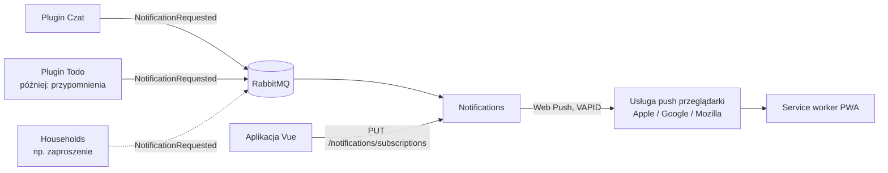
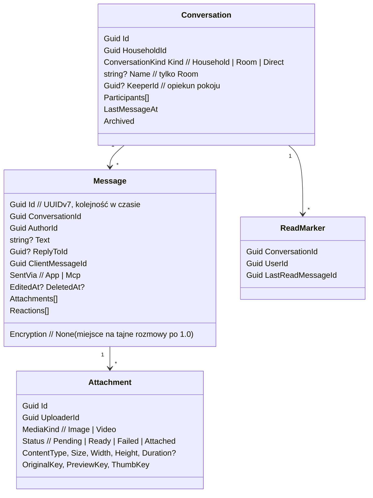
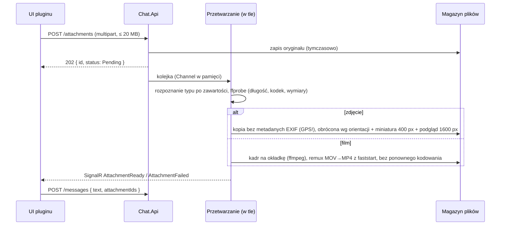

# Plugin Czat: plan v1 (zaakceptowany 2026-11-09, C1–C14 i N1–N4 rozstrzygnięte)

Data: 2026-11-09. Baza: HomeApps master `fc0ca8c` (2.1.0, SDK pluginów), wzorzec: plugin Todo (`~/Documents/RiderProjects/HomeApps.Todo`, `docs/plan.md`). Kod dopiero po akceptacji. Pytania do właściciela są w sekcji 9 (C1–C13), każde z propozycją.

## 0. W skrócie

- **Czat domowy** to drugi plugin HomeApps: komunikator dla domowników, tekst + zdjęcia + filmy (do **30 s i 20 MB**). Osobne repo `HomeApps.Chat`, własna baza `homeapps_chat`, własny kontener pod `/plugins/chat`, włączany per dom tak jak Todo.
- Czat jest pierwszym pluginem, który potrzebuje dwóch rzeczy, jakich HomeApps dziś nie ma: **czasu rzeczywistego** (wiadomość ma się pojawić od razu, a nie po 30 s odpytywania) i **plików** (przechowywanie, bezpieczne serwowanie, miniatury, sprawdzenie długości filmu).
- **Etap 0 (C9 ✅): Powiadomienia w rdzeniu HomeApps**, przygotowanie pod wszystkie pluginy: Web Push dla PWA, wysyłany przez nową usługę `Notifications` na zlecenie dowolnego pluginu (sekcja 1a). Czat jest jego pierwszym użytkownikiem, Todo dostanie z tego przypomnienia.
- Potem mały etap w HomeApps (**A**: kit 2.2.0, pole `realtime` w manifeście i token dla połączenia na żywo), a potem etapy w repo pluginu: **domena → API + media + SignalR → UI → Docker**. MCP projektujemy od początku (komendy i zapytania gotowe na narzędzia), ale sam serwer MCP jest **odłożony** (etap C5, poza 1.0).

## 1. Co już jest i czego brakuje

| Potrzeba czatu | Stan w HomeApps 2.1.0 | Braki |
|---|---|---|
| Manifest, włączanie w domu, uprawnienia wg roli, `IHouseholdAccess` | `HomeApps.Plugins(.Hosting)`, sprawdzone na Todo | nic |
| UI pluginu w Vue (`definePlugin`, `useHost`, widżety) | `@homeapps/plugin-sdk` | brak tokenu dostępu dla połączenia WebSocket (`useHost()` daje tylko gotowy Axios) |
| Wiadomości na żywo | brak (Todo odświeża co 30 s) | SignalR w pluginie, pole `endpoints.realtime` w manifeście (było w szkicu, wycięte w A1 "do czasu SignalR") |
| Pliki (zdjęcia, filmy) | brak w całym systemie | magazyn plików, podpisane linki, miniatury, `ffprobe` |
| Imiona autorów | `GET /households/{id}/members` daje imiona, ale **Gość dostaje 403** (D2a) | w czacie Gość musi wiedzieć, kto pisze (decyzja C4) |
| Powiadomienia, gdy aplikacja zamknięta | PWA jest (`vite-plugin-pwa`, `generateSW`), Web Push nie ma | Etap 0 (sekcja 1a) |
| Traefik / Cloudflare Tunnel | prefiks `/plugins/*` już działa | WebSocket przechodzi przez oba bez zmian; limit ciała żądania w Cloudflare (100 MB) jest powyżej 20 MB |

## 1a. Etap 0: Powiadomienia w rdzeniu HomeApps (C9 ✅)

Właściciel 2026-11-09: powiadomienia robimy **przed czatem, jako przygotowanie pod pluginy**. Wzorzec jak przy Auth i e-mailach: kto chce kogoś powiadomić, wysyła jedną wiadomość na kolejkę, a jedna usługa wie, jak ją dostarczyć.



- **Nowa usługa `src/Notifications`** (N1), cztery warstwy jak Auth/Accounts/Households, baza `homeapps_notifications`, trasa `/notifications` w Traefiku.
- **Kontrakt** w `HomeApps.Contracts/Notifications`: `NotificationRequested(UserIds[], HouseholdId?, Source /* id pluginu */, Category /* np. "message" */, Title, Body, Url, Tag?, Urgency)`. `Tag` zastępuje starsze powiadomienie tego samego wątku (np. 5 wiadomości z pokoju = jedno powiadomienie "5 nowych"). Plugin wysyła przez kit: `INotifier.NotifyAsync(...)` w `HomeApps.Plugins`, przez outbox, więc idzie razem z transakcją.
- **Subskrypcje**: jedna na urządzenie (`endpoint`, klucze `p256dh`/`auth`, `UserAgent` zgodnie z D6, `LastUsedAt`). Wygasłe (`404/410` od usługi push) usuwane od razu. `UserDisabled` usuwa subskrypcje osoby, `UserErased` wszystko o niej. *(Przy budowie Etapu 0: `MemberLeft` niepotrzebny, bo odbiorców zawsze wybiera plugin, a ten nie wyśle nic komuś, kto wyszedł.)*
- **Ustawienia osoby**: włącz na tym urządzeniu; wycisz dom; wycisz plugin w domu; "nie przeszkadzać" w godzinach (N3). Szczegóły, które zna tylko plugin (np. wyciszony pokój), sprawdza plugin, zanim w ogóle wyśle.
- **Front**: przejście `vite-plugin-pwa` na `injectManifest` (własny service worker z obsługą `push` i `notificationclick`), strona "Powiadomienia" w ustawieniach konta, przycisk "Włącz powiadomienia" (przeglądarka pyta tylko po kliknięciu). Service worker nie pokazuje powiadomienia, gdy okno z tym samym `Url` jest na wierzchu. Na iPhonie działa tylko po dodaniu aplikacji do ekranu początkowego (iOS 16.4+): aplikacja to podpowie.
- **SDK pluginów**: w manifeście opcjonalne `notifications: [{ category, name }]`, żeby ustawienia mogły pokazać "Czat: wiadomości" bez znajomości pluginu.
- **Klucze VAPID** w `.env` (`NOTIFICATIONS_VAPID_PUBLIC_KEY`, `..._PRIVATE_KEY`, `..._SUBJECT=mailto:właściciel`), skrypt do ich wygenerowania. Biblioteka: `Lib.Net.Http.WebPush` (MIT, N2 ✅).
- Treść powiadomienia przechodzi przez serwery Apple/Google zaszyfrowana (wymóg Web Push), więc mogą zobaczyć tylko, że coś przyszło.

| # | Pytanie | Propozycja |
|---|---|---|
| N1 ✅ | Osobna usługa czy część Accounts | **Przyjęte 2026-11-09.** Osobna `Notifications`: inne tempo zmian, w przyszłości też e-mail/JARVIS jako kanały. |
| N2 ✅ | Biblioteka Web Push | **Przyjęte 2026-11-09.** `Lib.Net.Http.WebPush` (MIT, utrzymywana), bez pisania szyfrowania samemu. |
| N3 ✅ | "Nie przeszkadzać" w 1.0 | **Przyjęte 2026-11-09.** Tak, proste godziny per osoba (np. 22:00–7:00, strefa z przeglądarki); powiadomienia w tym czasie przepadają, liczniki w aplikacji zostają. |
| N4 ✅ | Podgląd treści na zablokowanym ekranie | **Przyjęte 2026-11-09.** Domyślnie tak ("Ania: będę o 18"), w ustawieniach można przełączyć na "Nowa wiadomość w Dom". |


## 2. Model domeny (zakres `HouseholdUser`)



Cztery agregaty, bo każdy zmienia się w innym rytmie (rozmowa rzadko, wiadomości często, znacznik przeczytania przy każdym spojrzeniu, załącznik ma własny cykl przetwarzania). Każdy ma swoje repozytorium, `IUnitOfWork` jak w Todo.

- **`Conversation`**: rozmowa w domu. Przy pierwszym włączeniu pluginu (`PluginSwitchedOn.FirstTime`) dom dostaje rozmowę **"Dom"** (`Household`), do której należą wszyscy członkowie z uprawnieniem `chat.read` (lista uczestników nie jest zapisywana: wynika z członkostwa). **Pokój** (`Room`, C1 ✅ w 1.0) to rozmowa wybranych osób z domu, np. "Rodzice" albo "Opieka nad dziećmi": nazwa (do 60 znaków), jawna lista uczestników, opiekun (twórca). Zachowania: `CreateRoom(name, participants)`, `Rename`, `AddParticipants`, `RemoveParticipant`, `Leave`, `Archive`; zasady kto co może w C13. Rozmowa `Direct` ma dokładnie dwóch uczestników z tego samego domu i jest tworzona przy pierwszej wiadomości (`StartDirect(a, b)` zwraca istniejącą, jeśli już jest).
- **`Message`**: tekst w **Markdownie** (właściciel 2026-11-09; do 4000 znaków, zapisywany surowy, renderowany w UI) i/lub 1–10 załączników. Zachowania: `Send`, `Edit` (tylko autor, tylko tekst, bez limitu czasu, oznaczenie "(edytowano)", C6), `Delete` (autor zawsze, moderator w rozmowie domu; miękko: zostaje "Wiadomość usunięta", treść i pliki znikają od razu), `React(emoji)` / `Unreact` (jedna reakcja danego emoji na osobę), `ReplyTo` (cytat jednej wiadomości). `ClientMessageId` od klienta = idempotentne ponowienie wysyłki (ta sama wiadomość nie pojawi się dwa razy po zerwanym połączeniu). `SentVia` przygotowane pod MCP: wiadomość napisana przez JARVIS-a w imieniu osoby będzie oznaczona w UI.
- **`Attachment`**: wgrywany osobno przed wysłaniem wiadomości (pasek postępu, ponowienie bez utraty tekstu). `Pending` → po sprawdzeniu `Ready` (albo `Failed` z powodem) → `Attached` przy wysłaniu wiadomości. Nieużyty przez 24 h znika (zadanie w tle). Należy do osoby, która go wgrała; cudzego załącznika nie da się dołączyć.
- **`ReadMarker`**: do której wiadomości dana osoba przeczytała rozmowę. Z tego liczone są nieprzeczytane (licznik w menu i widżecie) i, jeśli zdecydujemy (C7), "Przeczytane przez…".

**Gość (C3 ✅):** tylko czyta, nigdzie nie pisze ani nie reaguje (też w pokojach, do których go dodano). Widzi wiadomości najwyżej od dnia dołączenia do domu (`JoinedAt` z `GET /households/{id}/members/me`; w pokoju: od chwili dodania, jeśli późniejsza). Granica działa też w API: `before=` nie zwróci nic starszego, a cytat w odpowiedzi na starszą wiadomość pokaże się jako "Starsza wiadomość". Gość, który wyszedł i wrócił, widzi od nowego dołączenia. Domownik i wyżej widzi całą historię.

Reguły w domenie (nie w handlerach): autor edytuje tylko swoje; limit załączników; uczestnicy pokoju i rozmowy `Direct` tylko spośród członków tego samego domu; pokój bez uczestników się archiwizuje, a gdy opiekun wychodzi, opiekunem zostaje najdłużej obecny uczestnik; po `MemberLeft` osoba traci dostęp do wszystkiego w tym domu, jej wiadomości zostają (C5); zarchiwizowana rozmowa jest tylko do odczytu.

## 3. Uprawnienia (manifest)

| Uprawnienie | Min. rola (C3 ✅) | Co daje |
|---|---|---|
| `chat.read` | Guest | czyta rozmowę "Dom" (Gość tylko wiadomości od dnia, w którym dołączył do domu) |
| `chat.write` | Member | pisze i reaguje, wysyła zdjęcia i filmy (Gość tylko czyta) |
| `chat.direct` | Member | rozmowy 1:1 z innymi domownikami (Gość nie zaczyna prywatnych rozmów i nie jest w nich zapraszany) |
| `chat.rooms` | Member | zakłada pokoje i dodaje do nich ludzi (Gościa też można dodać do pokoju: czyta go od chwili dodania) |
| `chat.moderate` | Admin | usuwa cudze wiadomości w rozmowie "Dom", przypina (później) |

Pokoje i rozmowy `Direct` są prywatne: **nikt poza uczestnikami ich nie czyta, także Owner i admin serwera** (jak prywatne listy w Todo, D2a). Moderacja dotyczy tylko rozmowy domu. Włączanie pluginu: `enablement.minRole = Admin` (jak Todo).

## 4. Media: zdjęcia i filmy

### 4.1 Limity (C2)

| | Formaty | Limit |
|---|---|---|
| Zdjęcie | JPEG, PNG, WebP, GIF (bez animacji w podglądzie) | 20 MB |
| Film | MP4, MOV (iPhone), WebM | 20 MB **i** 30 s (oba naraz) |
| Wiadomość | | do 10 załączników |

Czytam "do 30 s lub 20 MB" jako "żaden z limitów nie może być przekroczony". Klient sprawdza oba od razu po wybraniu pliku (rozmiar z `File`, długość z metadanych `<video>`), żeby nie wysyłać na próżno; **serwer sprawdza jeszcze raz** i to jego wynik się liczy (`ffprobe`, nie ufamy nazwie ani `Content-Type`, tylko zawartości).

### 4.2 Przetwarzanie po wgraniu



- **EXIF usuwany zawsze**: zdjęcia z telefonu mają współrzędne GPS domu; w czacie z gośćmi to realne ryzyko. Przy okazji obracamy wg orientacji, żeby zdjęcia nie leżały bokiem.
- **Filmy bez transkodowania w 1.0** (C8): iPhone nagrywa HEVC; Safari, Chrome i Edge na współczesnym sprzęcie to odtworzą, Firefox nie zawsze. Remux do MP4 z `faststart` jest tani i pozwala zacząć odtwarzanie przed pobraniem całości. Jeśli okaże się, że ktoś w domu nie widzi filmów, transkodowanie do H.264 to zmiana jednego kroku.
- Narzędzia: `ffmpeg`/`ffprobe` w obrazie Dockera (~80 MB), zdjęcia przez SkiaSharp (MIT; ImageSharp ma licencję Split, której nie chcę wnosić do projektu portfolio).
- Przetwarzanie w tle w tym samym procesie (`Channel<T>` + `BackgroundService`), bez osobnego workera. 30-sekundowy film to ułamek sekundy dla `ffprobe` i kilka sekund dla kadru.

### 4.3 Przechowywanie (C10)

Propozycja: **wolumin Dockera** `chat_media` montowany w kontenerze pluginu, pliki pod kluczami `households/{hid}/{attachmentId}/{original|preview|thumb}`. W kodzie port `IMediaStore` (Application) z jedną implementacją na dysku (Infrastructure): to nie abstrakcja na zapas, tylko granica warstw, bo Application nie dotyka systemu plików, a testy dostają wersję w pamięci. MinIO/S3 dopiero, gdy będzie po co (kopie poza domem, kilka maszyn).

Kopia zapasowa: wolumin trzeba dodać do tego, co właściciel już archiwizuje razem z Postgresem (dopiszę do `docs/deployment.md` w HomeApps).

Limit miejsca na dom (C11): domyślnie 10 GB, konfigurowalny; po przekroczeniu `409 chat.storage_full` przy wgrywaniu, tekst działa dalej. Admin domu widzi zużycie w ustawieniach pluginu.

### 4.4 Serwowanie plików

`` i `<video>` nie wyślą nagłówka `Authorization`, a pobieranie filmu przez Axios do `blob:` psuje przewijanie i strumieniowanie. Dlatego API zwraca przy wiadomości **krótkotrwałe podpisane linki** (HMAC, ważne 1 h, odnawiane przy kolejnym pobraniu listy):

```
/plugins/chat/media/{attachmentId}/{variant}?exp=1762718400&sig=…
```

Endpoint mediów jest anonimowy, ale sprawdza podpis i termin, obsługuje `Range` (przewijanie filmów) i ustawia `Cache-Control: private, max-age=3600`. Link wysłany komuś poza domem przestaje działać po godzinie. Klucz podpisu w `.env` (`CHAT_MEDIA_SIGNING_KEY`).

## 5. Czas rzeczywisty: SignalR

- Hub pluginu pod `/plugins/chat/hub` (manifest: `endpoints.realtime`). Traefik i Cloudflare Tunnel przepuszczają WebSocket bez zmian; awaryjnie SignalR sam przejdzie na long polling.
- Token: SignalR w przeglądarce wysyła go w zapytaniu (`?access_token=`), bo WebSocket nie ma nagłówków; plugin wpina to w `JwtBearerEvents.OnMessageReceived` tylko dla ścieżki huba.
- Klient po połączeniu woła `Watch(householdId)`; hub sprawdza członkostwo i włączenie **tą samą komendą MediatR** co HTTP (przechodzi przez `HouseholdPermissionBehavior`), potem dodaje połączenie do grup `household:{hid}` (rozmowa domu) i `user:{uid}` (pokoje, rozmowy 1:1 i własne załączniki; zdarzenia z pokoju idą do grup `user:` jego uczestników, więc dodanie i usunięcie z pokoju działa od razu).
- Zdarzenia do klienta (małe, bez plików): `MessageSent`, `MessageEdited`, `MessageDeleted`, `ReactionChanged`, `ReadMarkerMoved`, `RoomChanged` (nazwa, uczestnicy, archiwum), `AttachmentReady/Failed`, `Typing` (tylko w pamięci, nic w bazie). Wysyłane po zapisie transakcji (handler zdarzenia domenowego → `IHubContext`).
- Po `MemberLeft` / zmianie roli plugin wysyła do `user:{uid}` sygnał `AccessChanged` i wyrzuca te połączenia z grup domu, żeby osoba, która wyszła, nie dostawała dalej wiadomości do czasu wygaśnięcia cache roli.
- Jedna kopia kontenera wystarczy na dom; przy kilku kopiach potrzebny byłby backplane (Redis), zapisuję to jako ograniczenie.
- **Powiadomienia (Etap 0):** po zapisaniu wiadomości czat wysyła `NotificationRequested` do uczestników poza autorem, pomijając wyciszone rozmowy i osoby, które mają tę rozmowę otwartą (aktywne połączenie z `Watch` na tej rozmowie). `Tag` = rozmowa, więc kolejne wiadomości podmieniają powiadomienie. Gość też dostaje powiadomienia (czyta). W UI rozmowy: "Wycisz" (na zawsze / 8 h).
- Po zerwaniu połączenia klient pobiera brakujące wiadomości zwykłym `GET ...?after={ostatnieId}`, więc nic nie ginie.

## 6. API (Minimal APIs + MediatR 12, pod `/plugins/chat/api`)

| Metoda | Trasa | Uprawnienie |
|---|---|---|
| GET | `/households/{hid}/conversations` | `chat.read` (z licznikami nieprzeczytanych, pokoje i 1:1 tylko własne) |
| POST | `/households/{hid}/conversations/direct` `{ userId }` | `chat.direct` (zwraca istniejącą albo nową) |
| POST | `/households/{hid}/rooms` `{ name, participantIds[] }` | `chat.rooms` |
| PUT | `/households/{hid}/rooms/{cid}` `{ name }` | opiekun |
| POST | `/households/{hid}/rooms/{cid}/participants` `{ userIds[] }` | uczestnik z `chat.rooms` |
| DELETE | `/households/{hid}/rooms/{cid}/participants/{userId}` | opiekun |
| DELETE | `/households/{hid}/rooms/{cid}/participants/me` | uczestnik (wyjście) |
| POST | `/households/{hid}/rooms/{cid}/archive` | opiekun |
| GET | `/households/{hid}/conversations/{cid}/messages?before=&after=&limit=50` | `chat.read` (kursor po UUIDv7) |
| POST | `/households/{hid}/conversations/{cid}/messages` `{ clientMessageId, text?, attachmentIds[], replyToId? }` | `chat.write` |
| PUT | `/households/{hid}/messages/{mid}` `{ text }` | `chat.write` + autor |
| DELETE | `/households/{hid}/messages/{mid}` | autor albo `chat.moderate` (tylko "Dom") |
| PUT / DELETE | `/households/{hid}/messages/{mid}/reactions/{emoji}` | `chat.write` |
| PUT | `/households/{hid}/conversations/{cid}/read` `{ messageId }` | `chat.read` |
| POST | `/households/{hid}/attachments` (multipart) | `chat.write`, limit ciała 21 MB tylko na tej trasie |
| GET | `/households/{hid}/attachments/{aid}` | wgrywający (status przetwarzania) |
| GET | `/households/{hid}/unread` | `chat.read` (suma dla widżetu i plakietki) |
| GET | `/households/{hid}/storage` | `chat.moderate` (zużycie miejsca) |
| GET | `/media/{aid}/{variant}?exp=&sig=` (poza `/api`) | podpis |
| GET/PUT | `/households/{hid}/enablement` | z kitu |

Układ kodu jak w Todo i zgodnie z regułą właściciela: każda komenda/zapytanie w swoim folderze (`Messages/SendMessage/SendMessageCommand.cs`, `SendMessageValidator.cs`, `SendMessageHandler.cs`), jeden typ na plik. Limity na osobę: 30 wiadomości na minutę, 20 załączników na 10 minut (`429` jak w Households).

## 7. UI pluginu (Vue, `src/Chat.Web`)

- **Strona "Czat"** w domu: po lewej rozmowa "Dom", pokoje i rozmowy 1:1 z licznikami nieprzeczytanych (na telefonie lista → rozmowa, pełny ekran). Wiadomości grupowane po autorze i dniu, przewijanie w górę ładuje starsze, linia "Nowe wiadomości".
- Pole wpisywania: Enter wysyła (Shift+Enter nowa linia), spinacz i przycisk aparatu (`<input type="file" accept="image/*,video/*" capture>` na telefonie), podgląd wybranych plików z paskiem postępu i komunikatem od razu, jeśli film jest za długi albo za duży.
- Wiadomość wysłana optymistycznie (szara do potwierdzenia, "Ponów" przy błędzie), odpowiedź z cytatem, reakcje (6 stałych emoji na start), edycja i usuwanie z menu wiadomości.
- Zdjęcia jako siatka miniatur, po kliknięciu galeria na pełny ekran; filmy z okładką i odtwarzaczem wbudowanym w przeglądarkę.
- "… pisze" na dole rozmowy.
- Pokoje: "Nowy pokój" (nazwa + wybór domowników z listy), panel pokoju z uczestnikami, zmianą nazwy, dodawaniem osób, "Opuść pokój" i archiwum dla opiekuna. Komunikat w rozmowie przy zmianach ("Ania dodała Tomka").
- **Widżet "Czat"** (Medium, strona domu): ostatnie 3–5 wiadomości z rozmowy "Dom" i licznik nieprzeczytanych. Na `/wall` (wspólny tablet) tylko jeśli zdecydujesz (C12), bo tam widać czat każdemu, kto przechodzi obok.
- Imiona i awatary według decyzji C4. Gość widzi rozmowę domu i pokoje, do których go dodano; nie widzi pola wpisywania, reakcji ani przycisków "Napisz prywatnie" i "Nowy pokój"; na górze historii napis "Widzisz wiadomości od dnia dołączenia".

## 8. MCP: projekt teraz, budowa później

Serwer MCP nie wchodzi do 1.0, ale API jest pod niego ułożone, żeby potem był tylko cienką nakładką (jak w Todo, `ModelContextProtocol.AspNetCore`, JWT użytkownika):

| Narzędzie (później) | Komenda / zapytanie z 1.0 |
|---|---|
| `send_message(household, to?, text)` (`to` = osoba albo nazwa pokoju) | `SendMessageCommand` (`SentVia = Mcp`, bez załączników) |
| `unread_summary(household?)` | `GetUnreadQuery` + `GetMessagesQuery(after = ReadMarker)` |
| `read_conversation(household, with?, limit)` | `GetMessagesQuery` |
| `mark_read(household, conversation)` | `MarkReadCommand` |

Co już teraz robimy z myślą o MCP: uprawnienia sprawdza zachowanie MediatR (obejmie MCP bez zmian), `SentVia` w wiadomości, opis załącznika w odpowiedzi API (`"zdjęcie 1600×1200"`, `"film 12 s"`), żeby asystent mógł powiedzieć, co przyszło, bez otwierania pliku, oraz zapytania zwracające czytelny tekst i nazwy rozmów. Manifest dostanie `mcp.tools` dopiero w etapie C5.

## 9. Decyzje do podjęcia

| # | Pytanie | Propozycja |
|---|---|---|
| C1 ✅ | Jakie rozmowy w 1.0 | **Właściciel 2026-11-09: pokoje już w 1.0.** Rozmowa "Dom" + pokoje + rozmowy 1:1. |
| C2 ✅ | Limity mediów | Zdjęcie ≤ 20 MB; film ≤ 30 s **i** ≤ 20 MB; do 10 załączników w wiadomości. Oryginał zostaje do pobrania. |
| C3 ✅ | Co może Gość | **Właściciel 2026-11-09: tylko czyta, najstarsze widoczne wiadomości to te z dnia dołączenia.** Nie pisze, nie reaguje, nie prowadzi rozmów 1:1 ani nie zakłada pokoi. |
| C4 ✅ | Skąd imiona autorów, skoro Gość nie może czytać listy członków | **Przyjęte 2026-11-09.** Mała zmiana w Households: Gość dostaje `GET /households/{id}/members` w wersji okrojonej (imię/pseudonim + awatar, bez e-maili i ról). *(Zbudowane w Etapie A jako osobny `GET /households/{id}/members/names`, `{ userId, name, avatarUrl }` dla każdego członka, także Gościa; pełna lista `/members` bez zmian.)* Alternatywa: czat trzyma własną kopię imion z wydarzeń, ale to łamie zasadę "plugin nie trzyma kopii użytkowników" z `docs/plugins.md`. |
| C5 ✅ | Co z wiadomościami osoby, która wyszła z domu / ma usunięte konto | **Przyjęte 2026-11-09.** Wyszła: wiadomości zostają, podpisane "Były domownik". Konto usunięte (`UserErased`): treść i pliki jej wiadomości usuwamy, zostaje "Wiadomość usunięta". |
| C6 ✅ | Edycja i usuwanie | **Właściciel 2026-11-09: edycja zawsze, z oznaczeniem "(edytowano)".** Edycja tekstu przez autora bez limitu czasu. Usuwanie przez autora zawsze, przez Admina w rozmowie "Dom". |
| C7 ✅ | Potwierdzenia przeczytania | **Przyjęte 2026-11-09.** Licznik nieprzeczytanych tak; "Przeczytane przez…" tylko w 1:1 (w rozmowie domu bywa uciążliwe). |
| C8 ✅ | Transkodowanie filmów | **Przyjęte 2026-11-09.** Nie w 1.0: sprawdzenie `ffprobe`, okładka, remux do MP4. Transkodowanie do H.264, jeśli w praktyce coś się nie odtworzy. |
| C9 ✅ | Powiadomienia przy zamkniętej aplikacji | **Właściciel 2026-11-09: w rdzeniu HomeApps jako przygotowanie pod pluginy, Etap 0** (sekcja 1a, pytania N1–N4). Czat 1.0 już z nich korzysta. |
| C10 ✅ | Gdzie pliki | **Przyjęte 2026-11-09.** Wolumin Dockera `chat_media` + port `IMediaStore`. Bez MinIO na start. Pliki serwuje sam Chat.Api (Kestrel, `Range`); bez Caddy (pytanie właściciela 2026-11-09, odpowiedź w wątku). |
| C11 ✅ | Ile się trzyma | **Przyjęte 2026-11-09.** Wiadomości i pliki bezterminowo, limit 10 GB plików na dom (konfigurowalny). Bez automatycznego kasowania starych filmów. |
| C12 ✅ | Widżet na `/wall` | **Przyjęte 2026-11-09.** Nie. Widżet tylko na stronie domu; wspólny tablet nie pokazuje treści rozmów. |
| C13 ✅ | Zasady pokoi | **Przyjęte 2026-11-09.** Pokój zakłada Domownik i wyżej (`chat.rooms`), może do niego dodać też Gościa. Dodawać ludzi może każdy uczestnik z `chat.rooms`; usuwać innych, zmieniać nazwę i archiwizować tylko opiekun (twórca). Każdy może wyjść. Nowa osoba widzi całą dotychczasową historię pokoju. Admin domu nie widzi pokoi, w których go nie ma. |

| C14 ✅ | Szyfrowanie end-to-end | **Właściciel 2026-11-09: opcja 1.** Patrz sekcja 9b. **Nie w 1.0**, za to szyfrowanie kopii zapasowych; model gotowy na opcjonalne "rozmowy tajne" 1:1 po 1.0. |

Bez pytania przyjmuję: emoji z klawiatury systemu, brak wyszukiwania i przypinania w 1.0.

### 9a. Markdown (✅ właściciel 2026-11-09)

- Zakres: pogrubienie, kursywa, przekreślenie, `kod` i bloki kodu, linki, listy, cytaty. Bez nagłówków, tabel, obrazków z linku i surowego HTML (obrazki idą jako załączniki).
- Bezpieczeństwo: render w UI przez `markdown-it` z `html: false` + `DOMPurify`, linki z `rel="noopener noreferrer"` i `target="_blank"`; serwer trzyma surowy tekst i niczego nie renderuje.
- Pole wpisywania zostaje zwykłym tekstem (skróty Ctrl+B/I owijają zaznaczenie), podgląd na żywo nie jest potrzebny.
- Tam, gdzie Markdown nie ma sensu, idzie czysty tekst: treść powiadomienia push, odpowiedzi narzędzi MCP (JARVIS czyta to na głos), cytat w odpowiedzi, widżet.

### 9b. Szyfrowanie end-to-end (C14 ✅: bez E2E w 1.0, szyfrowane kopie zapasowe)

**Co by dało:** treści nie przeczyta nikt z dostępem do serwera ani do kopii zapasowej, także właściciel instancji (Owner hostujący aplikację). Dziś chroni nas TLS w drodze, a na serwerze dane leżą jawnie w Postgresie i na woluminie.

**Co by kosztowało** (każdy punkt to realna zmiana w tym planie):

| Obszar | Bez E2E (plan) | Z E2E |
|---|---|---|
| Klucze | brak | para kluczy na każde urządzenie, w IndexedDB; nowe urządzenie nie przeczyta historii bez kopii kluczy chronionej hasłem; wyczyszczenie danych przeglądarki = utrata historii |
| Pokoje i "Dom" | lista uczestników | zarządzanie kluczem grupy (MLS albo "sender keys"): każde dodanie/usunięcie osoby to wymiana kluczy; w JS brak dojrzałej biblioteki (libsignal ma powiązania tylko dla Node/Electron, OpenMLS przez WASM) |
| Media | serwer usuwa EXIF, robi miniatury, sprawdza długość `ffprobe` | wszystko w przeglądarce; serwer nie sprawdzi limitu 30 s ani nie usunie GPS, musi ufać klientowi |
| Powiadomienia | "Ania: będę o 18" | tylko "Nowa wiadomość", chyba że service worker ma klucze i odszyfruje (da się, ale to kolejna warstwa) |
| MCP / JARVIS | czyta i pisze przez API | serwerowy JARVIS nie przeczyta nic, chyba że dostanie własne klucze, co odbiera sens E2E; **koliduje z celem MCP** |
| Gość od dnia dołączenia, `UserErased` | reguły na serwerze | wynikają same z kluczy (Gość nie ma kluczy sprzed dołączenia); kasowanie działa |
| Nakład | plan jak wyżej | szacunkowo 2–3× więcej pracy w C1–C3 i dużo testów na kilku urządzeniach |

**Opcje:**
1. **Bez E2E w 1.0, za to szyfrowane kopie zapasowe** (Postgres + wolumin `chat_media` szyfrowane przy backupie, opis w `docs/deployment.md`). Model wiadomości dostaje pole `Encryption` (`None`), żeby później można było dodać opcję 2 bez migracji. *(propozycja)*
2. **Opcjonalne "rozmowy tajne" 1:1 po 1.0**, jak w Messengerze/Telegramie: tylko dla dwóch osób, tylko na wybranych urządzeniach, bez MCP i bez podglądu w powiadomieniu. Pokoje i "Dom" zostają bez E2E.
3. **E2E wszędzie od 1.0**: najmocniejsza prywatność, ale MCP traci sens, media bez kontroli serwera, wielokrotnie dłuższa budowa.

## 10. Etapy (każdy na osobnej lokalnej gałęzi do review)

| # | Repo / gałąź | Co | Gotowe, gdy |
|---|---|---|---|
| 0 | HomeApps `core/notifications` (2.2.0) | usługa `Notifications`, kontrakt `NotificationRequested`, `INotifier` w kicie, pole `notifications` w manifeście, service worker z push, ustawienia powiadomień w Vue, VAPID w `.env` i compose, `docs/notifications.md` | testy zielone; powiadomienie z plugina Hello dochodzi na Chromium i na iPhonie z PWA |
| A | HomeApps `plugins/realtime` (2.2.0) | opcjonalne `endpoints.realtime` w manifeście (zostaje `manifestVersion` 1), `IHouseholdAccess.GetMembershipAsync` (rola + `JoinedAt`, Households już to zwraca w `members/me`, kit dziś bierze tylko rolę), `useHost().accessToken()` w `@homeapps/plugin-sdk`, `IHouseholdAccess` czyta token także z `?access_token` (połączenia huba), zmiana z C4 w Households, `docs/plugins.md` | testy kitu i Households zielone, paczki 2.2.0 w `~/.homeapps/packages` |
| C1 | HomeApps.Chat `chat/domain` | repo (`.slnx`, `nuget.config`, `.editorconfig` jak Todo), `Conversation` (dom, pokoje, 1:1), `Message`, `Attachment`, `ReadMarker` + testy | testy domeny zielone |
| C2 | `chat/api` | Application, Infrastructure (`ChatDbContext`, migracja, `IMediaStore` na dysku, przetwarzanie z `ffprobe`/`ffmpeg`/SkiaSharp, podpisane linki, sprzątanie nieużytych załączników), Api (port 5410), hub SignalR, konsumenci `MemberLeft`/`MemberRoleChanged`/`UserErased`, testy API i huba | API i hub działają za Traefikiem w dev |
| C3 | `chat/web` | UI pluginu, widżet, i18n pl/en | sprawdzone w Chromium (Playwright) na dwóch kontach naraz: wiadomość i zdjęcie docierają bez odświeżania, Gość i telefon |
| C4 | `chat/docker` | Dockerfile z `ffmpeg`, `compose.yaml` z woluminem `chat_media`, `docs/plugin-chat.md` + szyfrowana kopia zapasowa Postgresa i woluminu `chat_media` w `docs/deployment.md` (HomeApps) | smoke na `compose.prod.yaml` |
| C5 | `chat/mcp` (po 1.0) | serwer MCP z sekcji 8 | MCP Inspector wywołuje narzędzia |

## Postęp

- 2026-11-09: Etap 0 (powiadomienia, HomeApps `dde1610`) i Etap A (realtime, HomeApps `354de68`) zmergowane.
- 2026-11-09: C1 `chat/domain`: cztery agregaty i 51 testów domeny. Uwagi z budowy: nowy opiekun pokoju to najdłużej
  obecny uczestnik (także Gość, wtedy nikt nie zmienia nazwy, dopóki ktoś nie wyjdzie: do poprawy w C2, jeśli będzie
  przeszkadzać); rozmowa 1:1 z osobą, która wyszła z domu, zostaje do odczytu (zarchiwizowana).
